# Petroleum Dashboard: PRAHARI

**A unified operations platform for India's fuel retail network.** It brings logistics, supply, retail outlets, compliance and security together in one live operational picture. It's built first for an oil company's **Sales Officer**, and designed to grow into a Palantir Gotham / Arondite Cobalt-style platform for the whole downstream fuel chain.

> **Status:** proof of concept, running on **synthetic data** for the Gurugram Sales Area (Haryana).
> No real oil company data, branding or systems are used.

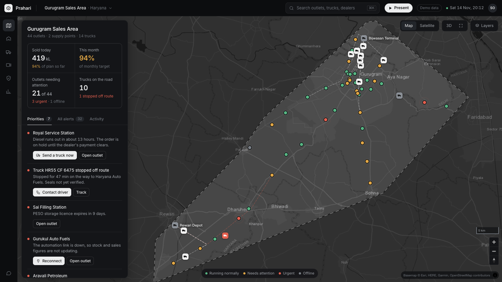

---

## Contents

1. [The problem](#1-the-problem)
2. [What PRAHARI does](#2-what-prahari-does)
3. [Quick start](#3-quick-start)
4. [Feature tour (with screenshots)](#4-feature-tour)
5. [5-minute demo script](#5-five-minute-demo-script)
6. [How the POC works](#6-how-the-poc-works)
7. [Repository structure](#7-repository-structure)
8. [Research & planning documents](#8-research--planning-documents)
9. [Limitations & disclaimer](#9-limitations--disclaimer)
10. [Tech stack & credits](#10-tech-stack--credits)
11. [Copyright](#11-copyright)

---

## 1. The problem

India has roughly 90,000 fuel stations. Most are run by dealers under the three public-sector Oil Marketing Companies (IOCL, BPCL, HPCL). Each **Sales Officer (SO)** looks after a territory of roughly 40–100 outlets. Their picture of that territory is spread across separate systems:

| Where the data lives | What it holds |
| --- | --- |
| OMC SAP (ERP) | Indents, invoices, payments, dealer credit |
| Retail Automation + tank gauges (ATG) | Tank stock, nozzle-level sales (automated outlets) |
| Vehicle Tracking System (VTS) | Tank truck GPS, halts, route deviation |
| Terminal Automation System | Loading quantity, density, seals |
| Paper registers, Excel, Tally | Dips, density, cash, credit customers, staff |
| WhatsApp and phone calls | Most of the day-to-day coordination |

Nothing joins these together. An SO can't easily answer questions like *"which outlets will run dry this weekend?"*, *"why is this outlet losing volume?"* or *"what needs my attention today?"*.

The full background is in the research doc: [How Indian petrol pumps work](docs/research/how-indian-petrol-pumps-work.md).

## 2. What PRAHARI does

PRAHARI (Hindi for *sentinel*) puts every piece of the territory on one live map. Every **outlet, tank, nozzle, tank truck, depot, dealer, inspection and camera** is linked to the things it relates to, so the SO can move from the whole area down to a single nozzle in two clicks.

**Core ideas the POC demonstrates:**

- **One operational picture:** a satellite map of the sales area with live status for every asset.
- **Outlet 360:** everything about an outlet on one screen: stock, sales, supply, cameras, compliance, dealer.
- **Proactive alerts:** dry-out risk, stock variation, density mismatch, trucks halted off-route, lapsed licences, equipment faults, offline cameras, falling sales.
- **Act, not just view:** priority dispatch, hold a tank and send a sample, contact a driver, schedule an inspection, remind a dealer.
- **Live monitoring:** tank levels drain, transactions stream, trucks move, CCTV feeds run with an AI-vision overlay.
- **Assistant:** ask questions about the area in plain language.

## 3. Quick start

There are two ways to run Prahari.

**With the backend** (data imported from OMC-style files, a live feed, alerts raised on the server, actions saved). You need Docker:

```bash
git clone https://github.com/AG-droid/petroleum-dashboard.git
cd petroleum-dashboard
make up        # then open http://localhost:8080   (API docs: /api/docs)
```

See [`backend/README.md`](backend/README.md) for what it does, the sample data, and how to let others try it.

**Dashboard only** (self-contained demo, simulated in the browser). No build step, no backend, no installation. You only need Python 3 (preinstalled on macOS) and a modern browser.

```bash
git clone https://github.com/AG-droid/petroleum-dashboard.git
cd petroleum-dashboard/poc
python3 -m http.server 8080
```

Then open **http://localhost:8080** in Chrome.

On macOS you can instead double-click [`poc/start.command`](poc/start.command). It picks a free port and opens the browser for you.

> An internet connection is needed for the map and satellite images. The map library is bundled in `poc/vendor/`, so without internet the dashboard still runs: outlets, trucks and all the data work, and a notice explains that the map images could not load. Best viewed at **1280 px width or more**.

**Shortcuts:** `⌘K` / `Ctrl+K` opens search · `Esc` closes panels.

**Presenting to someone?** Click **Present** (top right) for a guided, self-driving walkthrough of the product. See [Present mode](#present-mode-guided-demo).

**Deep links** (useful in demos):

| Link | Opens |
| --- | --- |
| `/#outlet=GGN-104` | An outlet directly. Add `&tab=sales`, `supply`, `cameras`, `compliance` or `dealer` |
| `/#view=surveillance` | A view: `ops`, `outlets`, `logistics`, `surveillance`, `compliance`, `analytics`, `copilot` |
| `/#base=sat` | Start in satellite view (combine with others, e.g. `/#view=ops&base=sat`) |

## 4. Feature tour

### Present mode (guided demo)

Click **Present** in the top bar, or open `/#tour`, to turn the dashboard into its own presentation. It works like a product-demo video, but it's the real, live product:

- **Story cards:** full-screen cards open and close the story, with the live dashboard blurred behind them.
- **Spotlight:** a highlight glides from feature to feature.
- **Captions:** plain-English captions explain what you're looking at.
- **Demo cursor:** a cursor clicks the real buttons. It opens an outlet, sends a truck, contacts a stopped tanker's driver, holds a bad delivery and asks the assistant a question.

| Key | Action |
| --- | --- |
| `→` / `Space` | Next step |
| `←` | Previous step |
| `A` | Auto-play (runs by itself, like a video) |
| `Esc` | Exit and explore freely |

Open `/#tour&auto` to start in auto-play. There are 21 steps, taking about 8–10 minutes with narration. **Watch again** reloads the page so every story starts fresh.

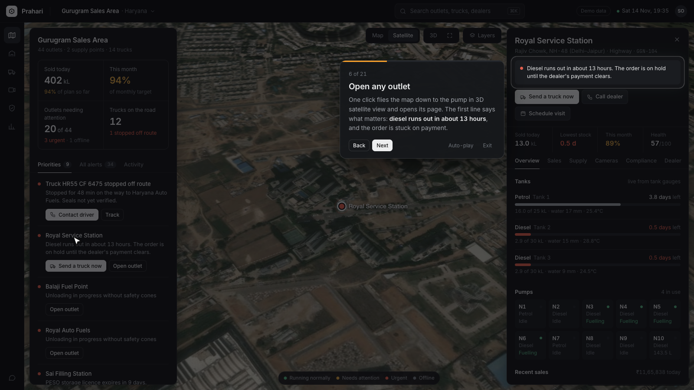

### Operations map (home)

The landing view flies in from all of India to the sales area. It's designed to be readable at a glance by someone seeing it for the first time.

- **Map:** a neutral dark map of the area that switches to **satellite** automatically when you zoom into an outlet. You can also pick either one yourself, and tilt the map in **3D**.
- **On the map:** 44 outlets coloured by status (running normally, needs attention, urgent, offline), 2 supply points, 14 tank trucks moving along their delivery routes, and the sales-area boundary.
- **Layers** (top-right button): competitor outlets, a sales heatmap and 3D volume columns.
- **Left panel:** four headline numbers (sold today, this month against target, outlets needing attention, trucks on the road), then three tabs:
  - **Priorities:** urgent items in plain English, each with a one-click action such as *Send a truck now* or *Contact driver*.
  - **All alerts:** every alert, filterable by category.
  - **Activity:** dispatches, deliveries and incidents as they happen.

### Outlet 360

Click any outlet. The map flies down to it in 3D and the detail panel opens.

| Overview: live sales, tanks, nozzles | Cameras: simulated CCTV with AI overlay |
| --- | --- |
| 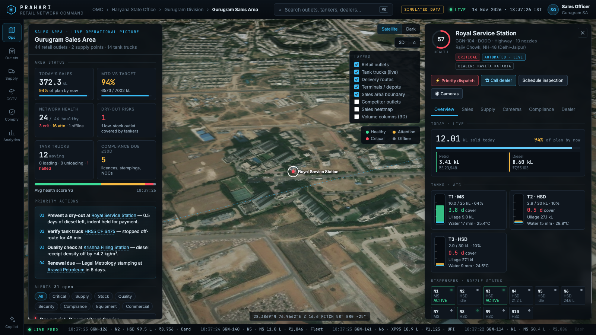 | 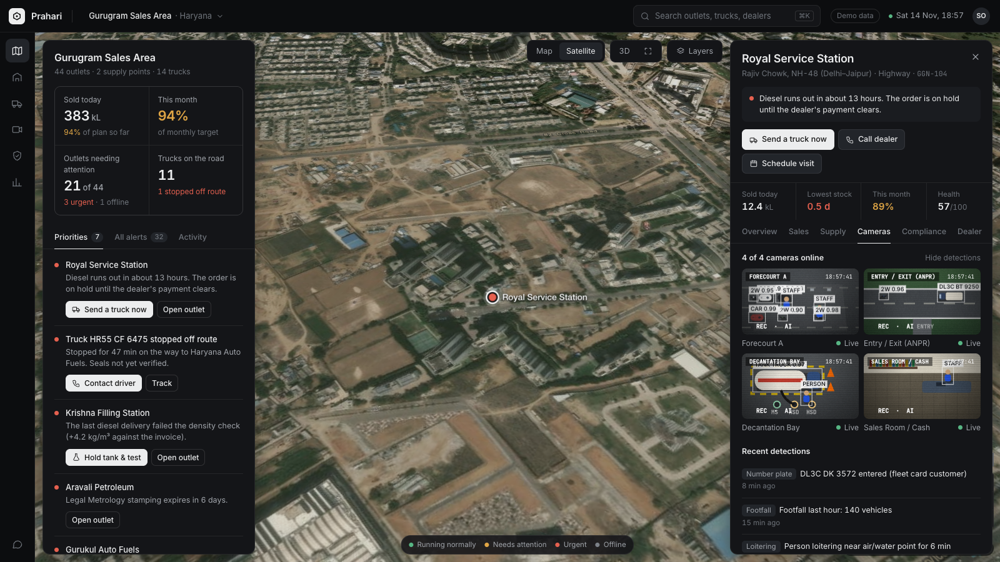 |

The top of the panel sums up the outlet's most important issue in one sentence, for example *"Diesel runs out in about 13 hours. The order is on hold until the dealer's payment clears."* Below that are four numbers: sold today, lowest stock, this month and health.

The panel has six tabs:

- **Overview:** tanks with days of fuel left, pump status, recent sales, a camera preview and open alerts.
- **Sales:** month-to-date against target, 7-day trend, estimated local market share, a 30-day chart, product mix and today's hourly profile.
- **Supply:** next delivery with ETA, seals and invoice; stock cover by product; indents and receipts with density checks; stock variation chart.
- **Cameras:** every camera at the outlet, with recent AI detections.
- **Compliance:** licences with days left, open irregularities, inspection history and complaints.
- **Dealer:** contact details, credit limit, outstanding and overdue amounts, and field notes.

The header also shows **context actions**. *Send a truck now*, *Hold tank & test* and *Reconnect automation* appear only when relevant; *Call dealer* and *Schedule visit* are always there.

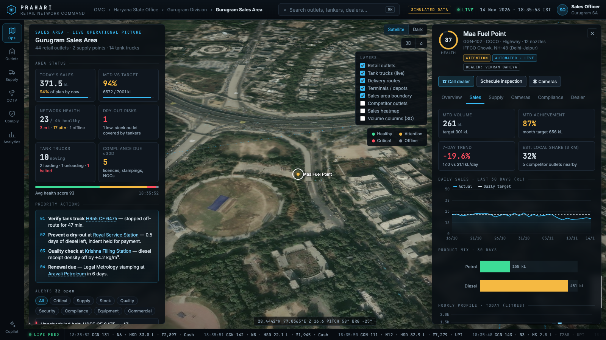

### Cameras & AI vision

A camera wall for the outlets that need attention most. The feeds cover the forecourt, entry/exit (with number-plate reading), the unloading bay and the cash room. They're drawn procedurally, with AI detection boxes (which can be hidden), queue counts and a detections feed. Click any feed to enlarge it, save a snapshot or speak to the site.

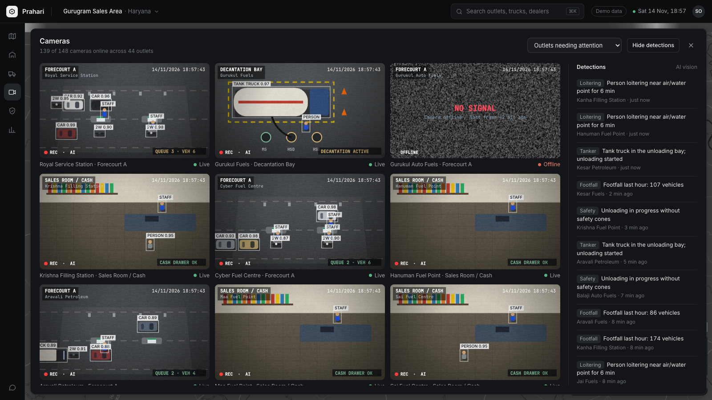

### Supply & logistics

Every tank truck with its destination, load, status, progress and arrival time. Below that are the outlets running lowest on fuel, with a *Send a truck* button, and supply-point status. Click a truck to track it on the map. A truck stopped off route can be resolved with **Contact driver**.

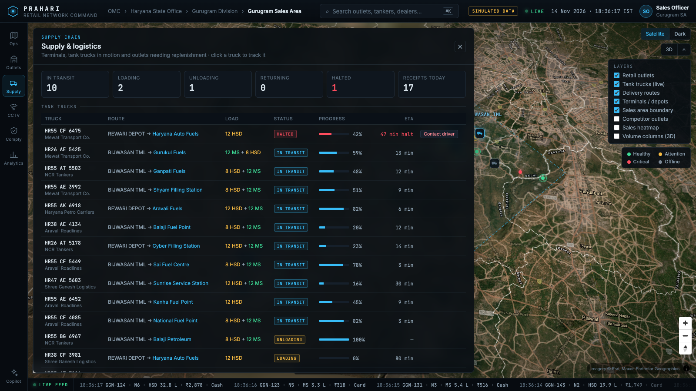

### Analytics

Area daily sales against target, the 12 outlets furthest behind target, product mix, estimated market share against competitor brands, and achievement by outlet category.

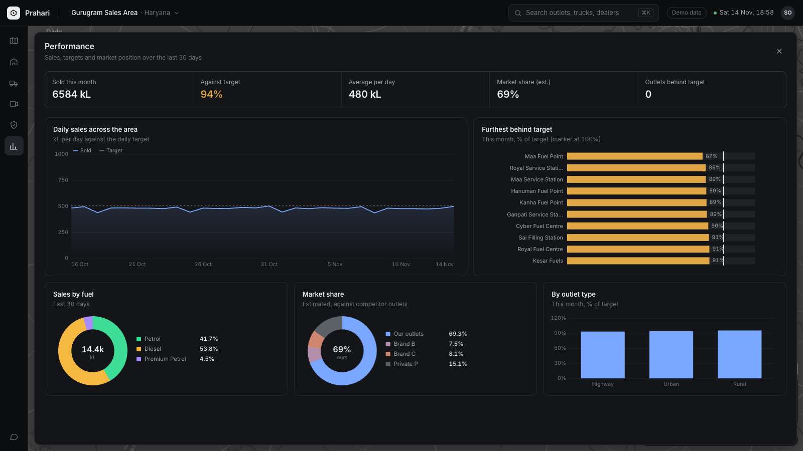

### Compliance & inspections

Upcoming statutory renewals: PESO licence, Legal Metrology stamping, fire NOC and pollution consent. Also open irregularities, and an inspection planner sorted by days since the last visit.

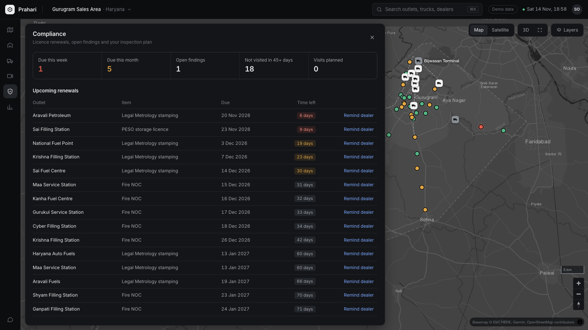

### Outlet registry

A sortable, filterable table of every outlet: status, sales today, achievement, stock cover, health score, alerts, CCTV status and last inspection.

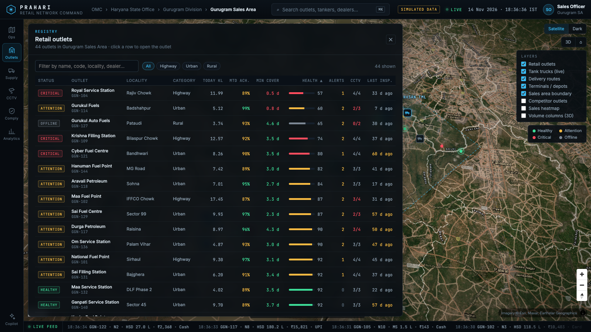

### Assistant (prototype)

Ask questions in plain language, such as *"Summarise my area"*, *"Which outlets may run dry?"* or *"How is Maa Fuel Point doing?"*. Answers are computed from the live data, with clickable links to outlets and trucks. It is rule-based today; an LLM would replace it in a later phase.

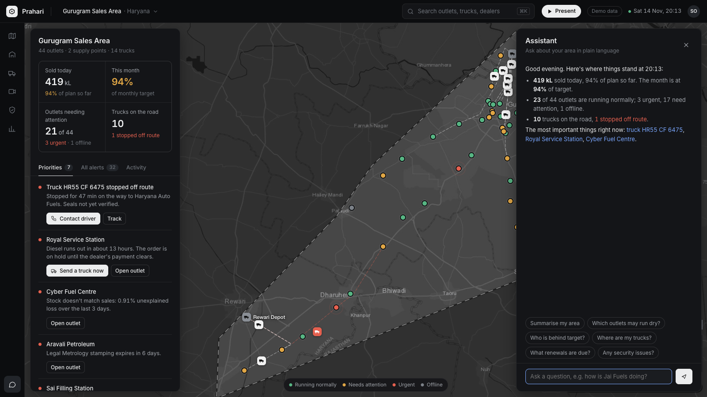

## 5. Five-minute demo script

The synthetic data includes scripted storylines so a demo always has something real-looking to act on.

1. **The big picture.** Let the intro fly in. Point out the four headline numbers, the coloured outlets and the moving trucks.
2. **Prevent a dry-out.** In *Priorities*, find **Royal Service Station**: diesel runs out in about 13 hours and the order is on hold for payment. Press **Send a truck now** and watch the urgent item clear.
3. **A security incident.** Truck **HR55 CF 6475** has stopped off route for 47+ minutes with seals unverified. Press **Contact driver**.
4. **A quality issue.** **Krishna Filling Station**'s last diesel delivery failed the density check. Press **Hold tank & test**.
5. **Zoom in.** Click any outlet. The map flies down to it in satellite 3D and the outlet panel opens.
6. **Cameras.** Open **Cameras** in the left rail: detection boxes, number plates, and an offline camera. Click a feed to enlarge it.
7. **Competition.** Turn on *Competitor outlets* under **Layers**, then open **Maa Fuel Point**. Sales are down about 20% on last week after a new competitor opened.
8. **Assistant.** Ask *"Summarise my area"*.

## 6. How the POC works

Plain HTML, CSS and JavaScript, loaded as ordinary scripts. There is no framework, bundler or server code.

```
data.js  ──►  sim.js  ──►  map.js / ui.js / cctv.js / charts.js
(seeded       (1-second tick:          (render the map, panels,
 synthetic     sales accrue, tanks      views and camera feeds;
 world)        drain, trucks move,      call Sim.actions on clicks)
               deliveries land,
               alert rules run)
```

| File | Responsibility |
| --- | --- |
| [`poc/js/data.js`](poc/js/data.js) | Generates the synthetic world from a fixed seed: roads of the Gurugram area, 44 outlets (tanks, nozzles, cameras, 30-day sales history, licences, inspections, dealer credit), 2 depots, 14 tank trucks with routes, competitor outlets, the sales-area boundary, and the **scripted storylines**. |
| [`poc/js/sim.js`](poc/js/sim.js) | The live engine. Each second it accrues sales by hourly demand profile, drains tanks, moves trucks (load → transit → unload → return → reassign to the lowest-stock outlet), lands deliveries, computes derived metrics (days of cover, achievement, trend, health score), runs the **alert rules engine** and generates random field events (camera offline, nozzle fault, complaints, AI detections). Also exposes the actions triggered from the UI. |
| [`poc/js/map.js`](poc/js/map.js) | The MapLibre GL map: satellite and dark basemaps, outlet, depot and truck markers, routes, boundary, competitor, heatmap and 3D-column layers, camera fly-to. |
| [`poc/js/ui.js`](poc/js/ui.js) | Everything else on screen: area panel, alert feed, outlet 360 tabs, the six views, assistant intent matching, search palette, ticker, toasts. |
| [`poc/js/cctv.js`](poc/js/cctv.js) | Procedurally drawn CCTV scenes (vehicles queue and fuel, tankers decant, number plates are read) with an AI bounding-box overlay, noise, scanlines and timestamps. |
| [`poc/js/charts.js`](poc/js/charts.js) | Small dependency-free canvas charts (line, bar, donut). |
| [`poc/js/main.js`](poc/js/main.js) | Startup, intro splash, deep-link handling. |

**Health score (0–100)** starts at 100 and deducts points for:

- low stock cover
- stock variation above the limit
- a density mismatch
- automation offline
- offline cameras or faulty nozzles
- licences due within 30 days
- being below target
- overdue dealer credit
- open irregularities

**Alert rules:**

| Rule | Severity |
| --- | --- |
| Stock cover < 1.5 days and no truck scheduled | Critical (dry-out risk) |
| Truck halted off-route | Critical |
| Stock variation > 0.5% | High |
| Density deviation > 3 kg/m³ | High |
| Automation offline | High |
| Licence due ≤ 30 days | Medium, or High if ≤ 10 days |
| Camera offline, nozzle fault, volume down > 12% week-on-week | Medium |
| Credit overdue > 30 days | Low |

The thresholds are demo values. Real limits would come from OMC guidelines.

## 7. Repository structure

```
petroleum-dashboard/
├── README.md                     ← you are here
├── poc/                          ← the runnable proof-of-concept dashboard
│   ├── index.html
│   ├── start.command             ← macOS double-click launcher
│   ├── README.md                 ← POC-specific notes
│   ├── css/styles.css
│   ├── js/                       ← data, sim, map, ui, tour, cctv, charts, api, main
│   └── vendor/                   ← bundled MapLibre GL JS (works offline)
├── backend/                      ← Python/FastAPI backend: importers, rules, API (see its README)
│   ├── src/prahari/
│   └── tests/
├── deploy/                       ← Docker Compose stack (database, API, feed, web server)
├── tools/                        ← helper scripts
├── Makefile                      ← make up / check / demo-data …
├── CLAUDE.md                     ← working agreement for AI agents (incl. the code-review agent)
└── docs/
    ├── research/
    │   ├── how-indian-petrol-pumps-work.md   ← industry primer (also .pdf)
    │   └── supply-chain-diagram.png
    ├── planning/
    │   └── architecture-and-scaling.md       ← hardware integration, architecture, team
    └── screenshots/                          ← images used in this README
```

## 8. Research & planning documents

| Document | What it covers |
| --- | --- |
| [How Indian petrol pumps work](docs/research/how-indian-petrol-pumps-work.md) | Industry structure, the supply chain, roles, a day at a pump, ordering and receiving fuel, **inventory of the data that exists today**, systems in use, money, compliance, the SO's world, pain points, and a validation checklist for dealer interviews. |
| [Architecture & scaling](docs/planning/architecture-and-scaling.md) | How forecourt hardware (dispensers, ATG, controllers) communicates; five realistic routes to the data; the edge gateway design; platform architecture and the data model; scale estimates; Indian PSU deployment constraints; team and engineering practices for a production system. |


## 9. Limitations & disclaimer

- **All data is synthetic.** Outlet names, dealers, phone numbers, vehicle plates, volumes and events are generated. Any resemblance to real outlets or people is coincidental. Map positions are approximate and don't correspond to real fuel stations.
- **Not affiliated with any oil company.** "OMC" is used generically and no company branding is used.
- **CCTV feeds are drawn procedurally.** No real video is used.
- **The copilot is rule-based**, not an LLM.
- **Prototype quality:** it targets desktop Chrome, has no authentication, no persistence (reloading resets the simulation) and no automated tests.
- Thresholds such as permissible stock variation and density tolerance are illustrative, not official.

## 10. Tech stack & credits

- **[MapLibre GL JS](https://maplibre.org/) 4.7.1:** map rendering (open source, BSD-3; bundled in `poc/vendor/` with its licence)
- **Esri World Imagery and reference layers:** satellite basemap, roads and labels (© Esri, Maxar, Earthstar Geographics and contributors)
- **Google Fonts:** Inter and JetBrains Mono
- Everything else (simulation, CCTV renderer, charts, UI) is hand-written vanilla JavaScript.

## 11. Copyright

Copyright © 2026 the Prahari authors. All rights reserved.

This repository is public so it can be viewed and shared for discussion. No license is granted to copy, modify, distribute or use the code, documents, designs or the "Prahari" name, in whole or in part, without written permission.

Third-party components keep their own licences: MapLibre GL JS is BSD-3-Clause (`poc/vendor/maplibre-gl-4.7.1/LICENSE.txt`). Esri map tiles and Google Fonts are loaded from their services under those providers' terms.
