# Prahari: how the whole system works

Diagrams of the dashboard, the backend, how data moves through them, and how the system is
operated day to day. Each diagram has a short explanation underneath. The diagrams are written
in [Mermaid](https://mermaid.js.org/), so GitHub draws them and anyone can edit them as text.
Rendered copies are in [`img/`](img/).

All data shown by Prahari is synthetic. File layouts are *modelled on* registers and exports
common in Indian fuel retail; they are not an official oil-company specification.

| # | Diagram | Answers |
| --- | --- | --- |
| 1 | [The big picture](#1-the-big-picture) | Who uses Prahari, and where does its data come from? |
| 2 | [Two ways to run it](#2-two-ways-to-run-it) | What changes between the standalone demo and the full system? |
| 3 | [What runs on the laptop](#3-what-runs-on-the-laptop) | Which containers start, and how do they talk? |
| 4 | [Starting the system](#4-starting-the-system) | What happens, in order, when you type `make up`? |
| 5 | [Inside the backend](#5-inside-the-backend) | Which part of the code does what? |
| 6 | [Importing a file](#6-importing-a-file) | How does an Excel/CSV export become trusted data? |
| 7 | [The live feed](#7-the-live-feed) | How do tank-gauge and pump readings arrive every 30 seconds? |
| 8 | [Working out stock "now"](#8-working-out-stock-now) | How does Prahari know how much fuel is in a tank right now? |
| 9 | [The stock check (variation)](#9-the-stock-check-variation) | How is pilferage or leakage spotted? |
| 10 | [How alerts live and die](#10-how-alerts-live-and-die) | When does an alert open, update, get acknowledged, resolve? |
| 11 | [The rules](#11-the-rules) | What exactly raises each alert? |
| 12 | [Pressing "Send a truck now"](#12-pressing-send-a-truck-now) | What happens end to end when the Sales Officer acts? |
| 13 | [Inside the dashboard](#13-inside-the-dashboard) | How is the browser app put together? |
| 14 | [Present mode](#14-present-mode) | How does the guided demo drive the real screens? |
| 15 | [The data model](#15-the-data-model) | What is stored, and how is it linked? |
| 16 | [A demo day](#16-a-demo-day) | What should the presenter do, and when? |
| 17 | [Sharing it with others](#17-sharing-it-with-others) | How can a brother or tester try it? |
| 18 | [How the code is built](#18-how-the-code-is-built) | How does a change get from idea to commit? |

---

## 1. The big picture

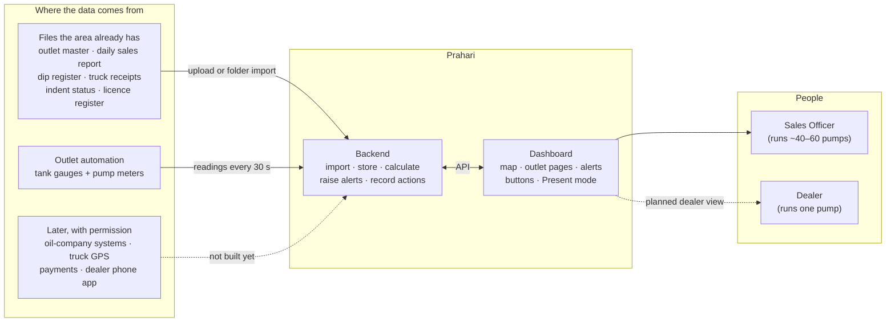

Prahari sits between the data a sales area **already produces** and the people who act on it.
The backend turns scattered files and readings into one picture and decides what needs
attention; the dashboard shows it and lets the Sales Officer act. Dotted lines are planned,
not built.

---

## 2. Two ways to run it

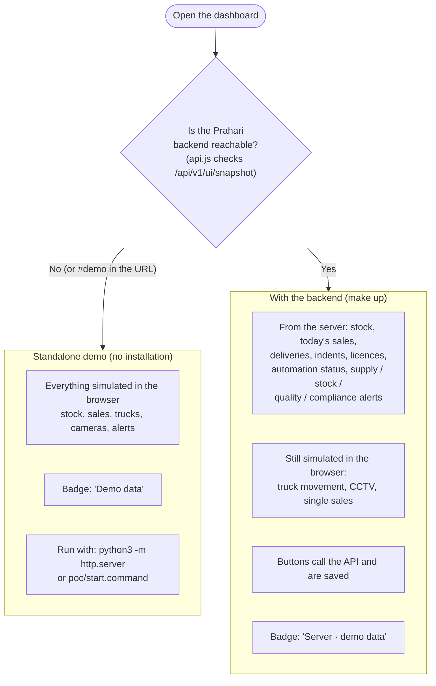

The same dashboard code runs both ways. Without a backend it is a self-contained demo, good for
a meeting with no setup. With the backend, the numbers come from imported files and the live
feed, and actions are recorded.

---

## 3. What runs on the laptop

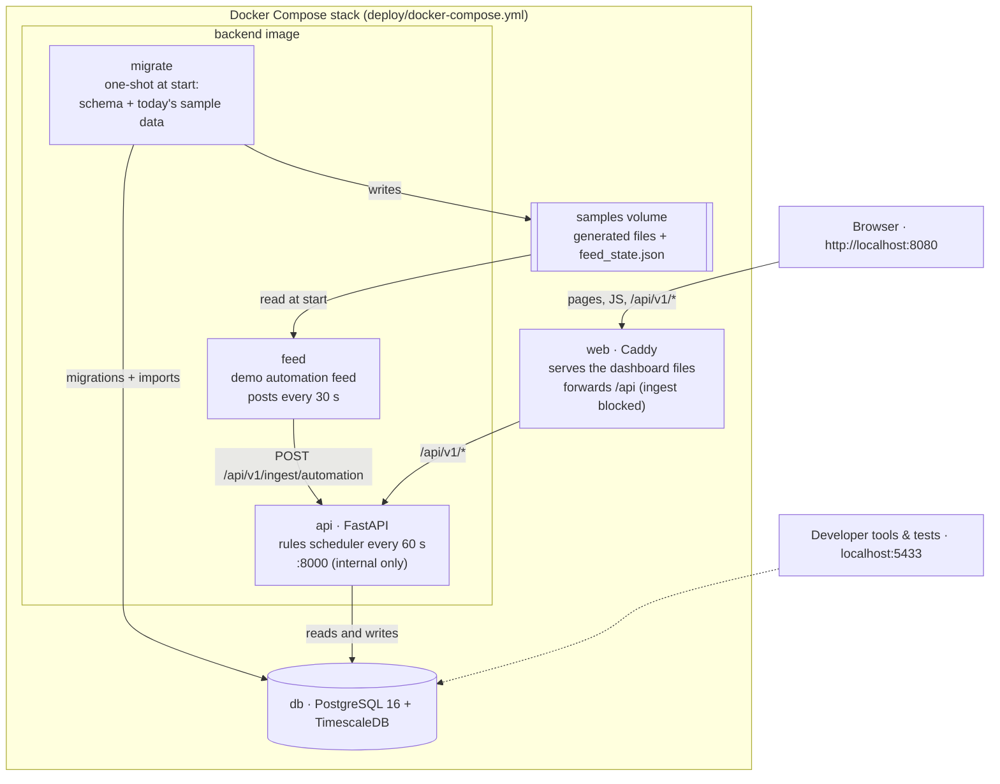

Five services, one command. The browser only ever talks to **web**, which serves the dashboard
files and forwards API calls. The machine-to-machine ingest endpoint is not reachable through
**web**; the feed posts straight to **api** on Docker's internal network. Ports are bound to
`127.0.0.1` unless you choose to share on your Wi-Fi.

---

## 4. Starting the system

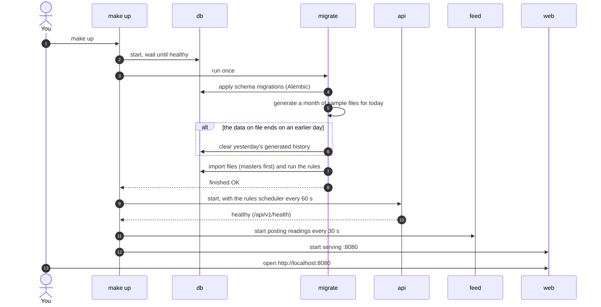

Each service waits for the one before it to be ready. Running `make up` again on the same day is
harmless: identical files are skipped, and your requests and holds are kept.

---

## 5. Inside the backend

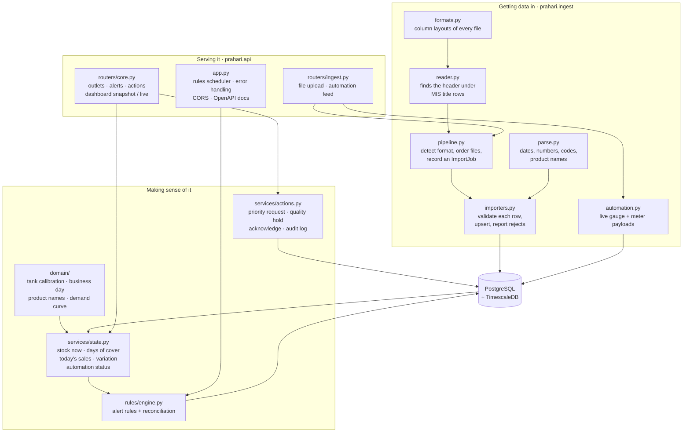

A deliberate rule: **`state.py` is the only place raw records become figures** (stock, cover,
variation). The rules engine and every API response use it, so an alert and the screen that
explains it can never disagree.

---

## 6. Importing a file

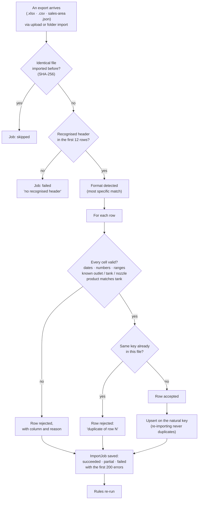

Every file is checked row by row; good rows load, bad rows are reported with the reason, and
nothing is duplicated if the same data arrives twice. Examples of checks: a meter reading lower
than yesterday's, net sales that don't add up, a dip deeper than the tank, a SAP code not in the
outlet master. Water at the bottom of a tank is subtracted from the dip, because it isn't fuel.

**Import order** (masters first, because later files refer to them):

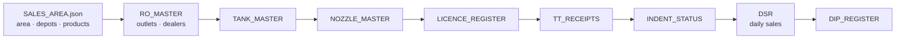

---

## 7. The live feed

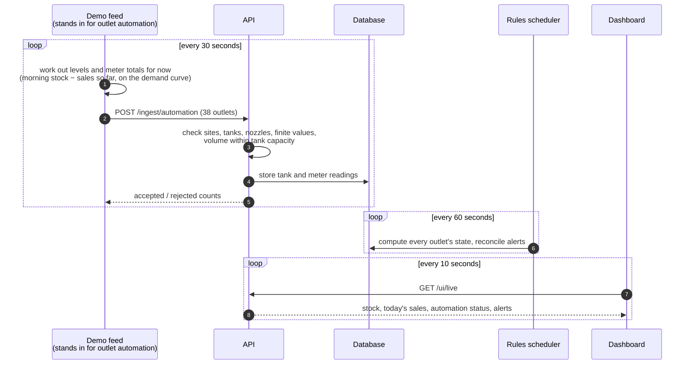

Real outlet automation would post the same payload. The feed skips the outlet scripted as
"automation offline", so the backend notices the silence and raises that alert by itself.
Today's sales at an automated outlet = latest meter reading − yesterday's closing meter reading.

---

## 8. Working out stock "now"

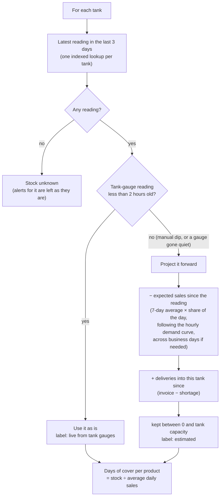

Most pumps are dipped by hand once a morning, so Prahari doesn't pretend that number is still
true at 6 pm: it subtracts what has probably been sold since and adds any truck that has been
emptied into the tank. Everything projected is labelled as an estimate on screen.

**The business day** runs from the morning dip, not midnight:

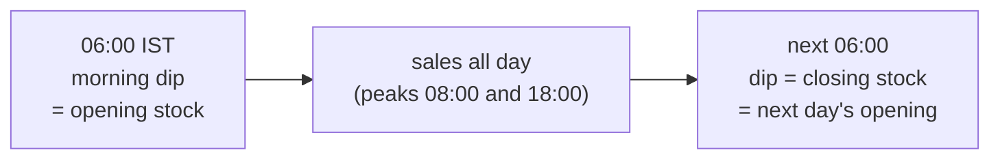

---

## 9. The stock check (variation)

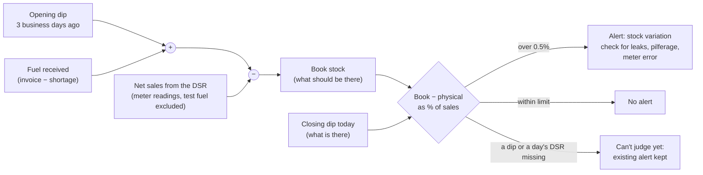

This is the classic outlet stock reconciliation, done automatically for every product at every
outlet, every minute. The 0.5% limit is an illustrative demo value, set in configuration.

---

## 10. How alerts live and die

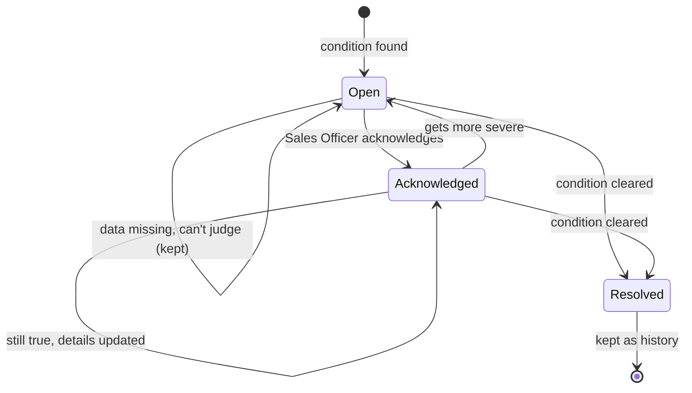

Every condition has a stable key, for example `dry:GGN-104:HSD` (diesel at outlet GGN-104), so
the same problem never opens twice. When data is missing (the morning dip not in yet, the feed
down) an alert is **kept**, not closed, so it doesn't flap and lose its acknowledgement. Runs
are serialised with a database lock: the scheduler skips a tick if busy; a run caused by a
user's action waits up to 5 seconds and never undoes that action.

---

## 11. The rules

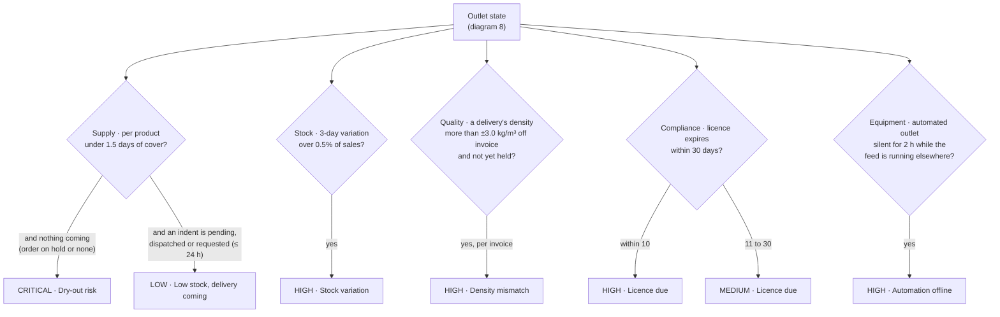

All thresholds are settings (`PRAHARI_RULE_*`), not code. Camera, nozzle, truck-route,
complaint and credit alerts are still produced by the dashboard's simulation; they move to the
server when real sources for them exist.

---

## 12. Pressing "Send a truck now"

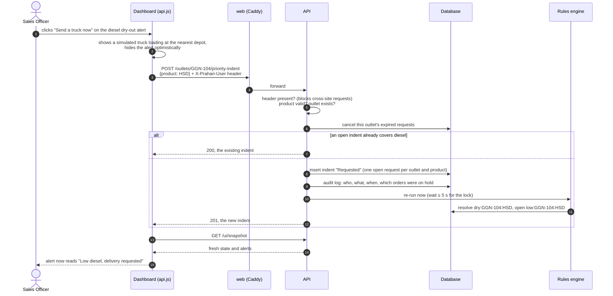

The button no longer conjures a truck: it files a **request** that the supply team would act
on, recorded with who asked. If nobody acts on it within 24 hours it stops counting as "fuel
coming" and the dry-out alert returns. "Hold tank & test" works the same way, holding every tank
that received the failed delivery.

---

## 13. Inside the dashboard

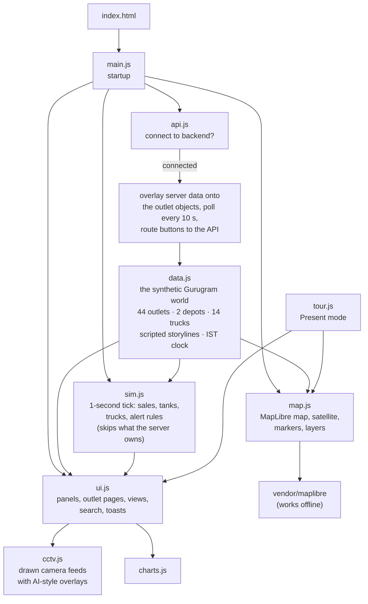

Plain HTML, CSS and JavaScript, with no build step. `data.js` defines the world; `sim.js` keeps
it moving; `api.js`, when a backend is present, replaces the simulated numbers with real ones.
All times are shown in India time, whatever the viewer's time zone.

---

## 14. Present mode

```mermaid
flowchart LR
    P["Click Present<br/>(or open #tour)"] --> HERO["Story cards<br/>the problem today"]
    HERO --> MAPS["Live map and<br/>day at a glance"]
    MAPS --> OUT["Open the dry-out outlet<br/>tank levels, live sales"]
    OUT --> ACT1["Demo cursor clicks<br/>'Send a truck now'"]
    ACT1 --> TRUCK["Truck stopped off route<br/>→ 'Contact driver'"]
    TRUCK --> DEN["Density failure<br/>→ 'Hold tank'"]
    DEN --> MORE["Cameras · competition<br/>supply · performance<br/>compliance · assistant"]
    MORE --> END["What happens next<br/>how you can help · thank you"]
```

21 steps. A spotlight, caption card and demo cursor drive the **real** screens and press real
buttons, so with the backend running the actions are genuinely recorded. Keys: → next,
← back, A auto-play, Esc exit.

---

## 15. The data model

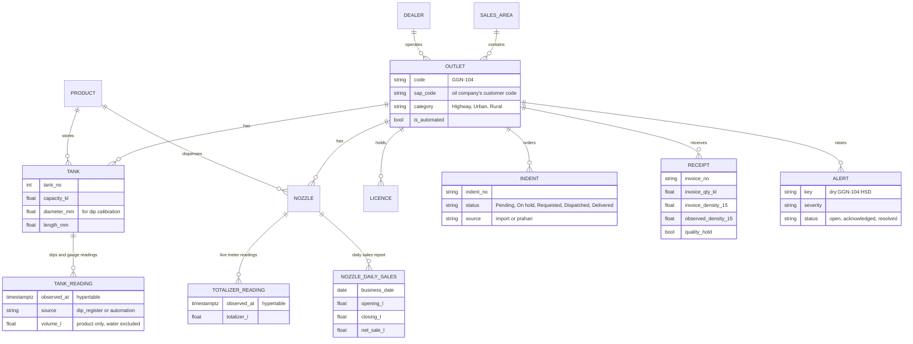

Also stored: **depots**, **import jobs** (every file, with its rejected rows) and the
**audit log** (every user action). Readings live in TimescaleDB hypertables, which stay fast as
a live feed adds thousands of rows an hour.

---

## 16. A demo day

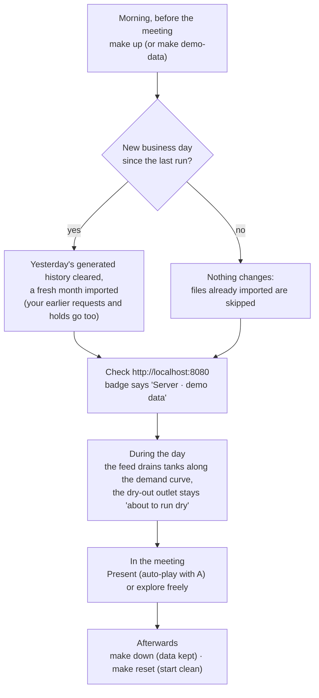

The demo day starts at 06:00 IST. The scripted outlets are set up so their stories stay true all
day: the dry-out outlet starts with about a day's diesel, so it is urgent but not yet empty.

---

## 17. Sharing it with others

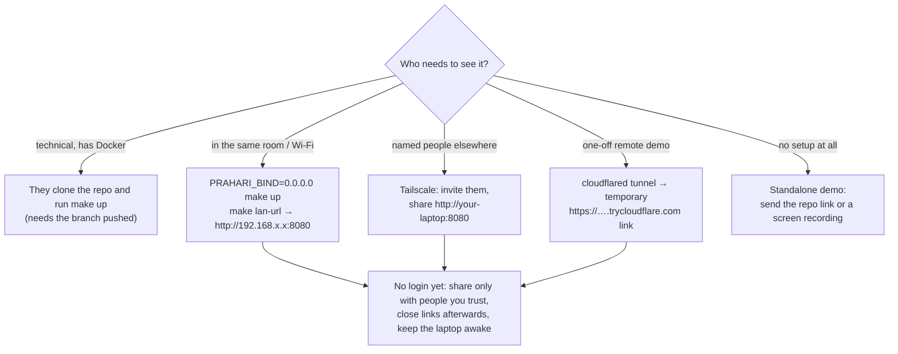

---

## 18. How the code is built

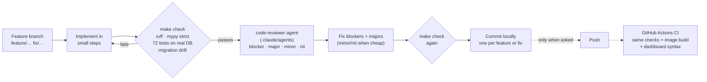

The working agreement is in [`CLAUDE.md`](../../CLAUDE.md). The reviewer has already run twice on
the backend: the first pass found 2 blockers and 7 major issues, the second confirmed the fixes
and caught 3 problems the fixes had introduced. All were fixed before committing.
