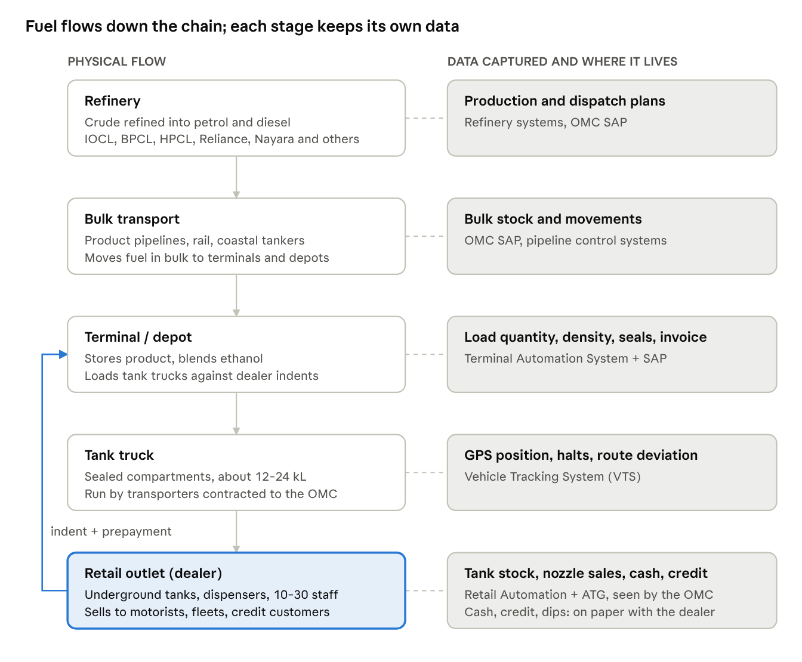

# How Indian Petrol Pumps Work: Operations, Data & Systems

Nov 14, 2026

A petrol pump ("Retail Outlet" or RO in industry language) is a dealer-run franchise of an oil company. The data that runs it is spread across the oil company's SAP, a few automation boxes at the forecourt, and a large amount of paper, Excel and WhatsApp. This doc maps that world from the inside: who does what, how fuel and money move, what data exists, and where it lives.

**How to read it.** It is written from general industry knowledge, not from any oil company's internal documents. Structures and processes are well established; numbers marked *approx.* are order-of-magnitude and should be checked. Practices vary by oil company, state and outlet, so treat every section as a hypothesis to confirm with your dealer contact. The checklist near the end is built for that conversation.

## 1. Industry structure

Three public-sector Oil Marketing Companies (OMCs) own roughly 90% of India's approximately 90,000+ fuel stations. The pump owner is almost never the oil company itself. It's a dealer operating under a dealership agreement.

| Company | Ownership | Retail outlets (*approx.*) | Notes |
| --- | --- | --- | --- |
| Indian Oil (IOCL) | Public sector | ~38,000–40,000 | Largest network; brands XtraPremium, XP95/100 |
| Bharat Petroleum (BPCL) | Public sector | ~22,000–24,000 | Speed, "Pure for Sure" quality programme |
| Hindustan Petroleum (HPCL) | Public sector (ONGC subsidiary) | ~22,000–24,000 | Power, Club HP |
| Nayara Energy | Private (Rosneft-backed) | ~6,500 | Largest private network |
| Jio-bp | Private (Reliance + bp) | ~1,800–2,000 | Fast-growing, tech-forward |
| Shell India | Private | ~350–400 | Premium urban sites |

**Who owns the land and assets.** Three outlet types decide who controls the site and the data:

- **DODO** (Dealer Owned, Dealer Operated) / **CODO** (Company Owned, Dealer Operated): the bulk of outlets. The dealer runs staff, cash and day-to-day operations; the OMC owns the brand, supplies fuel and usually the dispensing equipment.
- **COCO** (Company Owned, Company Operated): a small share, run directly by the OMC, often as model outlets on highways or in metros.
- **Kisan Seva Kendra (KSK) / rural outlets**: smaller-format rural outlets with lower volumes.

**Who regulates them.**

| Body | What it controls at the pump |
| --- | --- |
| Ministry of Petroleum & Natural Gas (MoPNG) | Policy, dealer selection guidelines, Marketing Discipline Guidelines (via OMCs) |
| PPAC (Petroleum Planning & Analysis Cell) | Industry data, consumption statistics |
| PESO (Petroleum & Explosives Safety Organisation) | Storage licence, tank and safety approvals |
| Legal Metrology (state departments) | Stamping and verification of dispensers, 5-litre measure checks |
| State Pollution Control Board / CPCB | Vapour recovery, effluent, environmental consent |
| BIS | Fuel quality standards (BS-VI, ethanol blends like E20) |

Since 2017 retail prices are revised daily (dynamic pricing). In practice, prices have been held largely flat for long stretches with OMC and government discretion, so the *mechanism* is daily but price *movements* are infrequent.

## 2. The supply chain

Fuel moves one way, from refinery to outlet, in roughly five stages. The only signal that flows back up is the dealer's indent and prepayment.

Each stage records its own data in its own system. The OMC sees stages 1–4 well; the outlet is split between OMC automation data and the dealer's paper records.

## 3. The people

The Sales Officer is the hinge: the only person who sees both the oil company's systems and the reality on the forecourt, across 40–100 outlets (*approx.*, varies widely by area).

| Role | Employer | What they do | Main tools today |
| --- | --- | --- | --- |
| Dealer | Self (franchisee) | Owns the business: capital, staff, credit customers, compliance, indents | OMC dealer portal / app, WhatsApp, accountant, Tally/Excel |
| Manager | Dealer | Runs shifts, takes dips, reconciles cash, receives tankers | Registers, ATG console, phone |
| DSMs (Driveway Salesmen / pump attendants) | Dealer | Dispense fuel, collect cash/UPI/card, check air, basic service | Nozzle, handheld POS / EDC, UPI QR |
| Sales Officer (SO) / Territory Manager | OMC | Owns a sales area: volume targets, dealer relations, inspections, complaints, new outlets | OMC SAP/portals, MIS reports, Excel, WhatsApp groups, field visits |
| Divisional / Regional Office | OMC | Manages a group of sales areas; sets targets, approves credit, handles escalations | SAP, BI dashboards, emails |
| State / Zonal Office, HQ | OMC | Pricing, network planning, policy, IT systems | SAP, data warehouse |
| Depot / Terminal staff | OMC | Load tank trucks against indents, quality samples, dispatch | Terminal Automation System, SAP |
| Transporter + driver | Contractor to OMC | Moves fuel from depot to outlet in a sealed tank truck | GPS / VTS device, phone |
| Inspectors | Legal Metrology, PESO, OMC quality teams | Verify measures, licences, quality, safety | Paper and handheld kits |

The OMC reporting chain is usually: Sales Officer → Divisional/Regional Office → State Office → Zonal Office → HQ. Titles differ across IOCL, BPCL and HPCL (e.g. "Territory Manager" at some), so confirm the local terminology.

## 4. A day at a petrol pump

Most outlets run 24 hours or close to it, in two or three shifts. The whole day revolves around one question: does the fuel that came in, minus the fuel that went out, match what is in the tanks and what is in the cash box?

1. **Price check (06:00).** Any price revision takes effect at 6 am. In automated outlets it pushes to the dispensers from the OMC system; elsewhere staff update dispensers and display boards by hand.
2. **Opening readings.** For every nozzle, the manager notes the opening totaliser reading. For every tank, a dip reading (manual dip rod or ATG) gives stock in litres after conversion through the tank's calibration chart.
3. **Density check.** Staff measure the density of petrol and diesel with a hydrometer and thermometer, convert to density at 15°C, and record it in the density register. Customers have the right to ask for this check.
4. **Shift sales.** DSMs sell fuel and collect cash, UPI, cards, fleet cards, loyalty redemptions and credit slips from credit customers. Each DSM is usually tied to specific nozzles.
5. **Shift change.** Closing totaliser per nozzle minus opening = litres sold. Litres × price = expected money. Each DSM settles cash and digital receipts against that figure; shortfalls are often recovered from the DSM.
6. **Tanker receipt (when due).** See section 5.
7. **Daily closing.** Day's sales per product, closing dip stock, variation (book stock vs physical stock), cash deposit to bank, credit sales ledger, expenses. Recorded in the Daily Sales Register / stock register and often reported to the SO.
8. **Housekeeping and service.** Free air, drinking water, toilets, first aid and complaint book are mandatory customer amenities and are checked in inspections.

**Normal vs suspicious variation.** Some loss from evaporation and temperature is expected. OMC guidelines set a permissible variation limit per product (ask your contact for the current figure; it differs for petrol and diesel). Persistent variation beyond it is investigated as leakage, theft or meter tampering.

## 5. Ordering and receiving fuel

Fuel is bought up front: the dealer pays the OMC before the tanker leaves the depot (or draws on an approved credit limit). Every tanker load ties up cash, which is why indenting is a daily cash-flow decision, not just a logistics one.

1. **Estimate need.** The dealer or manager looks at tank stock, ullage (empty space in the tank), expected sales and cash in bank. Typical tank trucks carry 12, 20 or 24 kL (*approx.*), split into compartments by product.
2. **Place the indent.** Through the OMC dealer portal/app (or SMS/phone at some outlets), naming product, quantity and supply depot.
3. **Pay.** Via net banking, RTGS or an OMC e-payment/ cash-management arrangement with partner banks. Credit, where allowed, is limited and secured.
4. **Allocation and loading.** The depot plans trucks, loads against the indent through its Terminal Automation System, seals each compartment and issues an invoice with quantity, density and seal numbers.
5. **Transit.** The truck is tracked by a GPS-based Vehicle Tracking System (VTS). Route deviation, unscheduled halts and seal tampering are the classic adulteration and pilferage risks.
6. **Arrival checks.** Before unloading, the manager checks seals against the invoice, dips each compartment, and measures density. Density must fall within a tolerance of the invoice figure (*approx.* ±3 kg/m³); outside it, the load can be refused.
7. **Decantation.** Fuel is drained into the underground tanks with the dispensers for that tank usually paused. Before/after dips (or ATG readings) confirm litres received.
8. **Record and dispute.** Receipt goes into the stock register; shortages beyond tolerance are reported to the SO and transporter.

**Where it goes wrong.** Dry-outs from late trucks or late payment, short deliveries, density mismatches, trucks arriving at night with no one qualified to receive, and disputes over who bears the loss.

## 6. The data that exists today

Almost every operational fact is already captured somewhere, but in at least five different places, at different frequencies, owned by different parties. The OMC holds the commercial and supply data; the dealer holds the forecourt and cash truth; much of it is still on paper.

| Data | Generated where | Lives in | Owner | Frequency | Format |
| --- | --- | --- | --- | --- | --- |
| Indents, invoices, payments, credit | Dealer portal → OMC | OMC SAP | OMC | Per order | Structured, digital |
| Tank truck loading (qty, density, seals) | Depot / terminal | Terminal Automation System, SAP | OMC | Per load | Structured, digital |
| Tank truck location and halts | GPS device on truck | VTS platform | OMC / transporter | Every few seconds–minutes | Digital stream |
| Tank stock and water level | ATG probe in each tank | Automation console, OMC central server | OMC (equipment) | Continuous (in automated ROs) | Digital |
| Nozzle-wise sales (litres, amount) | Dispenser (DU) | Automation system / DU controller | OMC | Per transaction | Digital |
| Manual dips, totaliser readings | Manager | Paper registers, Excel | Dealer | Per shift | Paper / semi-digital |
| Density | Manager with hydrometer | Density register | Dealer | Daily + each receipt | Paper |
| Cash, UPI, card, fleet card collections | POS / EDC, UPI QR, cash box | Bank statements, PSP apps, notebooks | Dealer | Per transaction / shift | Fragmented |
| Credit customer sales | Credit slips | Ledger, Tally | Dealer | Per sale | Paper / Tally |
| Loyalty and fleet-card transactions | OMC card systems | OMC loyalty / fleet platforms | OMC | Per transaction | Digital |
| Staff attendance, DSM shortages | Manager | Registers | Dealer | Daily | Paper |
| Price revisions | OMC HQ | SAP → automation / SMS | OMC | Daily mechanism | Digital |
| Inspections, audit findings, penalties | SO, quality teams | Inspection reports, OMC systems | OMC | Monthly–ad hoc | Forms, partly digital |
| Customer complaints | Complaint book, OMC call centre, app | Book; OMC CRM | Both | Ad hoc | Mixed |
| Licences and certificates (PESO, Legal Metrology stamping, fire, pollution consent) | Regulators | Files at outlet, SO records | Dealer | Annual / multi-year renewals | Paper / PDF |
| Equipment maintenance (DU, ATG, compressor) | Vendors / OMC engineering | Service tickets, OMC maintenance system | OMC / vendors | Ad hoc | Mixed |
| Non-fuel income (lubes, convenience store, car wash) | Outlet | Tally, separate POS | Dealer | Daily | Mixed |

The key point for a product: **the OMC already has rich digital data for automated outlets (ATG, nozzle sales, VTS, SAP), but no single view joins it, and the dealer's side (cash, staff, credit, compliance) is largely undigitised.**

## 7. Systems and tools in use

The OMCs run large, centralised enterprise systems; the dealer runs on phones, paper and Tally. Nothing links the two except the indent and the invoice.

**OMC side**

- **SAP (ERP).** All three PSU OMCs run SAP for sales orders, billing, dealer accounts, credit, inventory at depots and finance. This is the system of record.
- **Retail Automation (RA).** A forecourt controller connects the dispensers and ATG probes to the OMC's central server, enabling remote stock and sales monitoring, automatic price updates and interlocks against tampering. Most high-volume outlets are automated; coverage of smaller and rural outlets is lower (*approx.* the large majority of volume, not of outlet count; confirm per OMC).
- **Terminal Automation System (TAS).** Automates loading at depots: gantry control, metering, sealing, invoice.
- **Vehicle Tracking System (VTS).** GPS on contracted tank trucks with geofences around depots and outlets, alerts on deviation and unscheduled stops.
- **Dealer portals and mobile apps.** Each OMC has its own (for indenting, account statements, payments, grievances). Names and features change; ask the dealer which one they use daily.
- **Customer and fleet programmes.** Loyalty and fleet programmes (e.g. IOCL XTRAREWARDS, BPCL PetroBonus and SmartFleet, HPCL DriveTrack Plus) with fleet cards with their own transaction platforms.
- **MIS and BI.** Regional and HQ dashboards built on SAP data; SOs commonly receive Excel extracts and build their own trackers.

**Dealer side**

- Dispenser displays and ATG console (where present)
- Handheld POS/EDC machines and UPI QR codes from banks/PSPs
- Tally or a local accountant for books and GST
- Paper registers: stock, density, daily sales, complaints, attendance
- WhatsApp: the real coordination layer with the SO, transporter, staff and credit customers

**Integration reality.** RA vendors, VTS vendors, loyalty platforms and SAP each have their own databases and interfaces. An external product would need either an OMC-sanctioned integration or must collect data at the outlet itself.

## 8. Money

A petrol pump is a high-turnover, thin-margin business. The dealer earns a fixed commission per litre set by the OMCs, not a percentage of price, so profit depends on volume, controlling losses and cheap working capital.

- **Dealer margin.** Roughly ₹3–4 per litre on petrol and ₹2–3 per litre on diesel (*approx.*; revised periodically and a recurring dealer-association demand). A small part is linked to the investment and to sales of premium fuels.
- **Working capital.** Fuel is prepaid. A mid-sized outlet selling ~150–200 kL a month moves crores of rupees through its bank account every month while keeping only lakhs as margin.
- **Credit sales.** Local transporters, fleets, institutions and government vehicles often buy on credit. The dealer carries this risk; bad debts and slow payments are a major pain.
- **Digital payment costs.** Card MDR and settlement delays eat into thin margins; UPI is free to the customer but has its own reconciliation load.
- **Other income.** Lubricants, convenience stores, car wash, air (nitrogen), ATM rentals and EV chargers at some outlets.
- **Costs.** Staff (often 10–30 DSMs), electricity, maintenance, licences, evaporation and handling losses, penalties.

The money view that matters to the dealer — daily cash position against the next indent, credit outstanding by customer, staff shortages — is exactly what today's OMC systems don't show.

## 9. Compliance and inspections

The dealer operates under the **Marketing Discipline Guidelines (MDG)**, a common rulebook issued by the PSU OMCs that lists irregularities and their penalties, from warnings and fines up to suspension of sales and termination of the dealership. Inspections are frequent and much of the SO's time goes into them.

| Check | Who checks | What they look at | Consequence if failed |
| --- | --- | --- | --- |
| Quality / adulteration | SO, OMC quality teams, mobile labs | Density, samples sent to labs, filter paper test for petrol | Severe: sales suspension, termination for adulteration |
| Quantity (short delivery) | SO, Legal Metrology | 5-litre certified measure test at each nozzle, seals on dispensers | Penalty, sealing of the dispenser |
| Meter stamping | Legal Metrology | Valid stamping/verification of dispensers and measures | Fine under Legal Metrology Act |
| Stock variation | SO via RA/stock records | Book vs physical stock beyond the permissible limit | Investigation, penalty |
| Tampering | SO, RA alerts | Unauthorised electronics, broken seals, RA bypass | Among the most severe MDG offences |
| Safety | PESO, fire, OMC | Licence validity, fire extinguishers, earthing, no-smoking, tank integrity | Licence suspension |
| Customer amenities | SO | Air, water, toilets, complaint book, display boards (prices, density, licences) | Warning, fine |
| Environment | SPCB / OMC | Vapour recovery (in notified cities), oil-water separators | Consent issues |

A few failures, especially adulteration and tampering, can end a dealership. This makes dealers sensitive about who sees their data: a product that exposes problems to the OMC will feel threatening unless it clearly helps the dealer first.

## 10. The Sales Officer's world

The SO is measured on volume and market share in their area, and spends most of the day firefighting across dozens of outlets with data stitched together by hand.

**What they're measured on (typical KPIs)**

- Sales volume vs target, by product (petrol, diesel, premium fuels, lubricants)
- Market share against the other OMCs in the area
- Growth of new outlets: commissioning on time, ramping up volume
- Inspections completed, irregularities found and closed
- Customer complaints resolved, dry-outs avoided
- Dealer outstanding / credit discipline

**A typical week**

- Morning check of yesterday's sales and stock across outlets (MIS or Excel extracts)
- Chasing dealers who haven't indented or paid, so their outlets don't run dry
- Field visits: inspections, sample collection, 5-litre checks, meeting dealers
- Handling complaints from customers, the call centre or social media
- Coordinating with depots and transporters on delays
- New outlet work: land, approvals, construction, commissioning
- Reporting upwards: weekly reviews, ad-hoc data requests from the regional office

**What they can't easily see today**

- A single live picture of all outlets: stock, days of cover, trucks en route, alerts
- Early warning of a dry-out (low stock + no indent + unpaid)
- Which outlets are losing volume to a competitor nearby, and why
- Patterns across outlets: repeated variation, repeated tanker delays on a route, DU downtime
- Compliance calendar: which licences and stampings are due this month
- A dealer's full history (inspections, complaints, payments) on one screen before a visit

## 11. Pain points, gaps and data access

The biggest gaps sit where data from different owners has to be joined: stock with indents with trucks, sales with cash, inspections with history. That join is the core of a Gotham-style platform, and it is also where access is hardest.

| Pain point | Who feels it | Data needed to fix it | Who holds that data | Access difficulty |
| --- | --- | --- | --- | --- |
| Dry-outs | Dealer, SO | Tank stock, sales rate, indent status, truck ETA | RA (OMC), SAP (OMC), VTS (OMC) | High without OMC |
| Cash and shift reconciliation | Dealer | Nozzle sales, payment receipts, DSM assignment | Dispenser/RA, banks/PSPs, dealer | Medium: available at the outlet |
| Stock variation and pilferage | Dealer, SO | Dips/ATG, receipts, sales | Dealer + RA | Medium |
| Tanker delays, short deliveries | Dealer, SO | VTS, invoices, receipt dips | OMC, transporter, dealer | High for VTS |
| Credit customer tracking | Dealer | Credit slips, payments | Dealer | Low: dealer's own data |
| Compliance renewals | Dealer, SO | Licence dates, stamping dates | Dealer files | Low |
| Territory-wide visibility | SO, regional office | All of the above, across outlets | OMC | Very high: needs OMC partnership |
| Competitor awareness | SO | Nearby outlets, prices, volumes | Public / field intelligence | Medium |

**What this means for entry.** Data owned by the dealer (cash, credit, staff, dips, compliance) is reachable today with the dealer's permission. Data owned by the OMC (SAP, RA central servers, VTS) needs a formal agreement, security review and procurement process. A product can start on the first and earn its way to the second.

## 12. Questions to ask your dealer contact

Use these to confirm or correct this doc. Tick them off as you go.

**Their outlet**

- [ ] Which OMC, which outlet type (DODO/CODO), and roughly how many kL a month?
- [ ] Is the outlet fully automated (ATG + RA)? Can they see the ATG data themselves, or only the OMC?
- [ ] How many staff, shifts and nozzles?

**Daily operations**

- [ ] What do they record on paper vs in a system? Can they show the actual registers?
- [ ] How do they reconcile cash, UPI and cards per DSM each shift? How long does it take?
- [ ] What is the permissible stock variation they work to, and how often do they exceed it?

**Supply**

- [ ] How do they place indents (app, portal, phone)? How far ahead? How often do they run dry?
- [ ] How do they know when the tanker will arrive? Do they see VTS data?
- [ ] How often do they get short deliveries or density mismatches, and how are disputes settled?

**Money**

- [ ] Current margin per litre; how much credit do they give and to whom?
- [ ] What software do they use for accounts (Tally, Excel, an accountant)?

**The Sales Officer**

- [ ] How often does the SO visit, call or message? What do they ask for most?
- [ ] What reports does the dealer have to send the SO, and in what format?
- [ ] What makes an SO's life hard, in the dealer's view? Would they introduce you to one?

**Product appetite**

- [ ] If one app showed stock, cash, credit, tankers and compliance together, would they pay? How much a month?
- [ ] Would they be comfortable sharing that data with the OMC, or only keeping it to themselves?
- [ ] Do they know other dealers (or dealer associations) who would try it?

## Glossary

| Term | Meaning |
| --- | --- |
| ATG | Automatic Tank Gauge: probe in the underground tank measuring fuel and water level |
| CODO / DODO / COCO | Company/Dealer Owned, Dealer/Company Operated: who owns the site and who runs it |
| Decantation | Unloading fuel from the tank truck into the outlet's underground tanks |
| Density at 15°C | Standardised fuel density; the main quick test for adulteration |
| Dip / dip rod | Manual measurement of fuel height in a tank, converted to litres via a calibration chart |
| DSM | Driveway Salesman: forecourt attendant |
| DU / MPD | Dispensing Unit / Multi-Product Dispenser: the fuel pump machine |
| EDC / POS | Card swipe / payment terminal |
| HSD / MS | High Speed Diesel / Motor Spirit (petrol) |
| Indent | Dealer's order for a tank-truck load of fuel |
| kL | Kilolitre, 1,000 litres; outlet volumes are quoted in kL per month |
| MDG | Marketing Discipline Guidelines: OMCs' rulebook of irregularities and penalties |
| OMC | Oil Marketing Company (IOCL, BPCL, HPCL and private players) |
| PESO | Petroleum & Explosives Safety Organisation: licenses fuel storage |
| RA | Retail Automation: links dispensers and ATGs to the OMC's central systems |
| RO | Retail Outlet: the industry term for a petrol pump |
| SO / TM | Sales Officer / Territory Manager: OMC officer in charge of a sales area |
| TAS | Terminal Automation System at depots |
| TT | Tank Truck (tanker lorry) |
| Totaliser | Cumulative litres counter on each nozzle, used for shift sales |
| Ullage | Empty space remaining in a tank; caps how much can be received |
| VTS | Vehicle Tracking System: GPS tracking of tank trucks |
