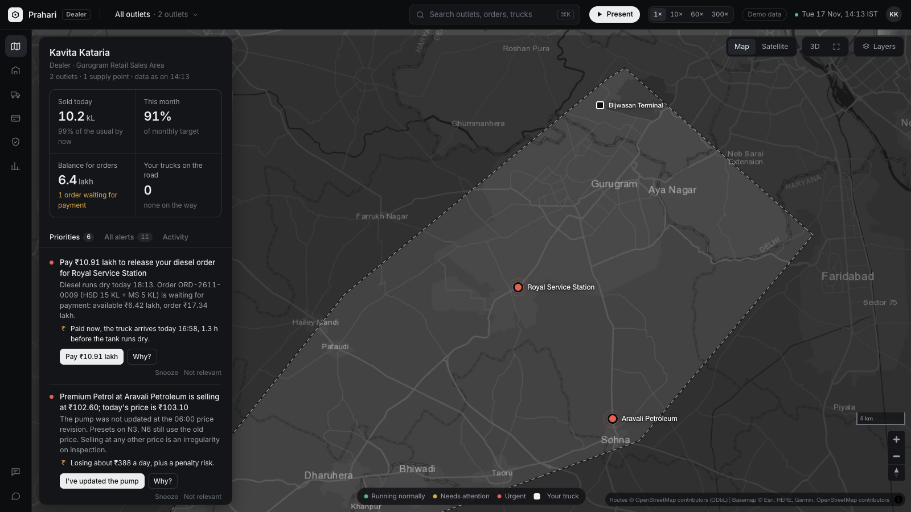

# Prahari for dealers (proof of concept)

The dealer's side of Prahari: one place to see every outlet, know what to do next, order fuel, pay for it, track the truck and check what arrived. It is built exactly like the Sales Officer dashboard (live map, left panel, outlet panel, overlays, search, assistant, Present mode), centred on the dealer. Instead of making the dealer dig through reports, the left panel's **Priorities** list says what to do next, each with the reason, the money at stake and a one-tap action.

Everything is **synthetic**. The demo dealer runs two outlets from the Sales Officer dashboard's world: **990104 Royal Service Station** (highway) and **990118 Aravali Petroleum** (city). The two apps show the same outlets, tanks, depots and roads.



## How to run

From the repository root:

```bash
cd poc
python3 -m http.server 8080
# open http://localhost:8080/dealer/
```

No backend and no build step. The map needs an internet connection for its tiles; everything else runs offline. It works on a phone (bottom tab bar) and on a laptop.

## What's in it

The layout and behaviour are the Sales Officer dashboard's, centred on the dealer:

| Area | What it shows |
| --- | --- |
| **Map** (home) | Your outlets, coloured by status and always labelled. The supply points that serve them, and your own tank trucks moving on the real roads with the road ahead dashed. Zooming into an outlet switches to satellite in 3D. **Layers** adds a 3 km catchment, competitor outlets, the truck road network and the sales-area boundary. |
| **Left panel** | Four headline numbers: sold today against the usual by now, the month against target, the balance you can order with, and your trucks on the road. Then **Priorities**: what to do, most money at stake first, each with the reason, the ₹ impact, the numbers behind it (**Why?**) and the fix as a button. Also **All alerts** (filter by category) and **Activity**. |
| **Outlet panel** (click an outlet) | One line on what matters, with the fix as a button, plus **Order fuel** and **Sales Officer**. Then key numbers and tabs. **Overview:** tanks with dead stock hatched, pumps, price board, recent sales, to-dos. **Sales:** 30 days against target, today by hour against the usual, bill size, vehicles, payment modes, local market share. **Supply:** next delivery or the suggested order, usable stock and run-dry times, deliveries with shortages, the day's stock book. **Integrity:** price and presets, nozzles not selling, flow-rate variance, water, gauges, reconciliation, dispenser events with action-taken reports. **Compliance:** renewals, observations, inspection history. |
| **Truck panel** (click a truck) | Plate, order, status and arrival time, route, load, driver, invoice and trip log. |
| **Orders & trucks** | Order counts by stage, suggested orders, the supply pipeline (run-dry with and without orders), every order with its next step, and your supply points' hours and cut-off. |
| **Account & payments** | Balance, money held for released orders, payments on their way, your collection account, payments, a running ledger and invoices (CSV download). |
| **Compliance** | Renewals across your outlets (book them here), inspection observations, inspection history. |
| **Performance** | Daily sales against target, month to date by outlet, fuel mix, today by hour, payment modes and vehicles. |
| **Sales Officer** | Requests, complaints and claims with the Sales Officer, with simulated replies. |
| **Assistant** | Plain questions: "what should I do first?", "when will diesel run out?", "how much do I need to pay?", "where is my truck?". The answers are computed from the live data, with buttons to act. |
| **Search** | `⌘K` / `Ctrl+K` for outlets, orders, invoices, trucks, UTRs and actions. |
| **Present mode** | **Present** (or `#tour`) gives a guided demo that drives the live screen, like the Sales Officer's. |
| **Demo clock** | 1× to 300× in the top bar. |

Forms open as dialogs: new or changed order, pay by RTGS/NEFT with the UTR (no money moved), receipt check and shortage claim, action-taken report, renewal booking, closing an observation, message to the Sales Officer, morning brief preview.

## The demo story

At start-up, the cards say:

1. **Pay ₹10.9 lakh to release the diesel order for 990104.** Usable diesel (dead stock excluded) runs out within hours, and the order is waiting for payment. The Sales Officer dashboard shows the same order "on hold for payment".
2. **Premium petrol at 990118 is priced ₹0.50 below today's price.** The pump and presets were not updated at the 06:00 revision.
3. **Stamping at 990118 expires in 6 days.**
4. **Nozzle N5 at 990104 has sold nothing since opening.**
5. **Raise a claim: yesterday's petrol load was 85 L short.**
6. **A dispenser controller was reset overnight.** It needs an action-taken report.
7. **Water in the diesel tank, a nozzle flowing slowly, an open inspection observation, behind target.**

**Suggested walkthrough:** press **Present**, or try it yourself: in Priorities, press **Pay ₹10.91 lakh**, then **Fill a demo UTR**, then **Record payment**. Set the clock to **300×**. The payment is credited, the order releases, the truck loads and appears on the map driving the real road, then unloads. Click the truck to follow it, then confirm the receipt. Every other item's action works too, and the item disappears once its cause is fixed.

## Deep links

- `#outlet=990118&tab=integrity` (`overview`, `sales`, `supply`, `integrity`, `compliance`)
- `#view=logistics` (`outlets`, `logistics`, `account`, `compliance`, `analytics`, `messages`, `copilot`)
- `#tour` (`#tour&auto` plays by itself, `#tour&step=7` jumps to a step)
- `#speed=60` starts the demo clock at 60× (`1`, `10`, `60`, `300`)

## How the recommendations work

The rules are plain and explainable. Every threshold lives in `js/config.js` (for example dead stock fraction, safety hours, transit loss, flow-rate variance, water limit, claim window), never inside a rule.

- **Run-dry time** walks forward through the hourly sales curve, using the last 7 days' average and usable stock. A plain "stock ÷ today's sales so far" overstates cover early in the day; the outlet page shows both.
- **When to order** = run-dry time − safety margin − (payment credit + depot queue + loading + drive + unloading), with the depot's loading hours and order cut-off.
- **Suggested order** = enough for the target cover at arrival, limited by tank space at arrival, packed into whole compartments, with spare compartments topped up.
- Cards are ranked by severity, deadline and money at stake. **Snooze** brings a card back after 2 hours if it still applies. **Not relevant** asks for a reason, which can later tune the rules.

## Code layout

```
poc/dealer/
├── index.html      the Sales Officer dashboard's shell (shares ../css/styles.css, ../js/data.js, roads, charts)
├── css/dealer.css  the few additions on top of the shared styles
└── js/
    ├── config.js   thresholds and business constants
    ├── world.js    the demo dealer, outlets, history, orders, ledger and storyline
    ├── engine.js   simulated clock, forecasts, suggested orders, lifecycle, recommendation rules, actions (no DOM)
    ├── ui.js       shell, left panel (day at a glance, Priorities, alerts, activity), search, selection
    ├── map.js      the map: your outlets, supply points, trucks, routes, catchment, competitors
    ├── panel.js    the right-hand panel: outlet tabs and truck
    ├── views.js    overlays: outlets, orders & trucks, account, compliance, performance, messages, assistant
    ├── forms.js    toasts, dialogs and the forms behind recommendation actions
    ├── orders.js   new order, payment, receipt, order detail
    ├── account.js  invoice CSV, message to the Sales Officer
    ├── tour.js     Present mode (the Sales Officer tour's engine, dealer story)
    └── main.js     start-up and deep links
```

`make dealer` (part of `make check`) runs `tools/check_dealer.mjs`. It loads the engine in Node at three times of day and checks the forecasts, suggestions, payment validation, the order lifecycle, claims and the storyline.

## What would be real

In a real deployment, tank, pump and sales data would come from the oil company's automation exports or APIs. Orders would still be placed in the oil company's system, and payments made from the dealer's bank. Prahari prepares, tracks and reconciles them.
